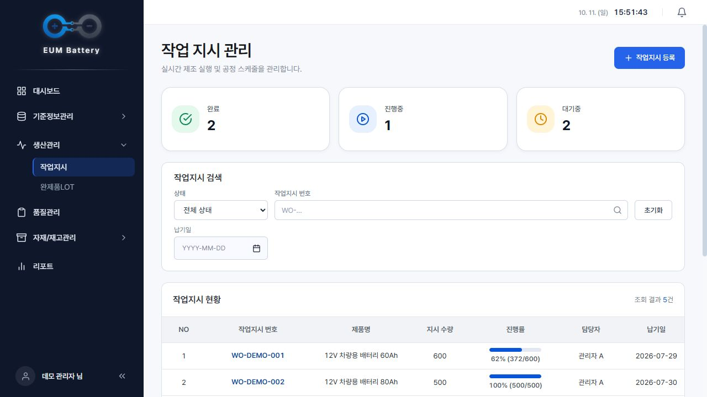
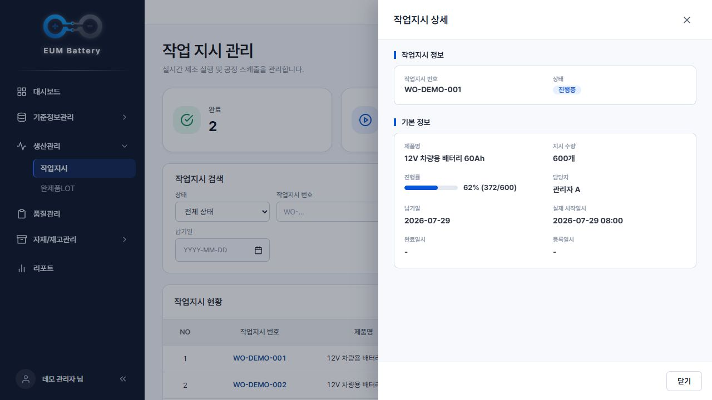
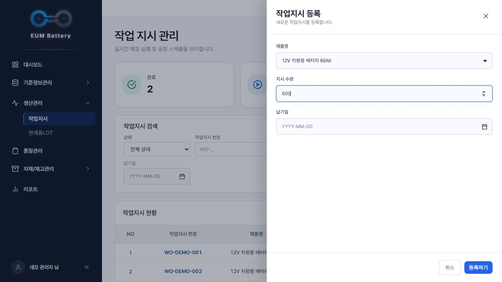
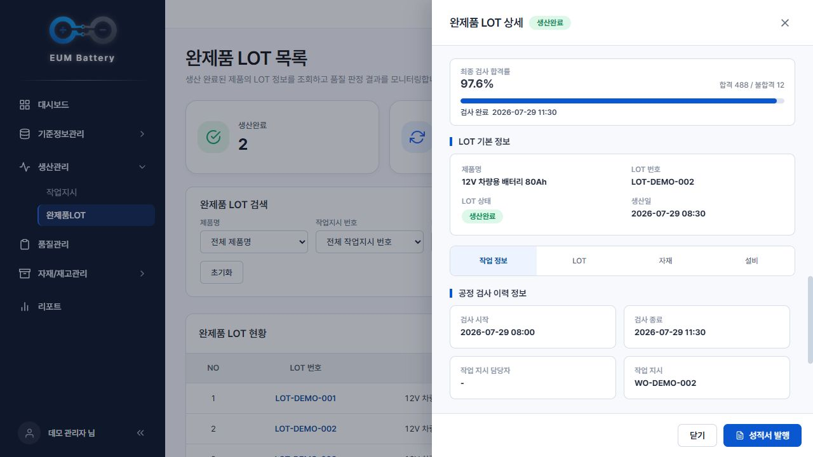

# 🔋 이음 배터리 MES

12V 차량용 납축전지 생산의 작업지시·공정·품질검사·완제품 LOT·자재 투입 이력을 연결하는 제조실행시스템(MES)입니다.

**5인 팀 프로젝트를 홍유나의 개인 포트폴리오로 정리한 통합 저장소**입니다. React 화면, Spring Boot 서버, C 설비 시뮬레이터를 한곳에 모았습니다. 개인 담당은 **생산관리·기준정보 화면과 프로젝트/API 문서 정리**입니다.

## 프로젝트 개요

| 항목 | 내용 |
| --- | --- |
| 개발 기간 | 2026.07.08 ~ 2026.07.29 |
| 발표 | 2026.07.30 |
| 구성 | 5명 |
| 화면 | React · JavaScript · styled-components |
| 서버·DB | Java 17 · Spring Boot · JPA · MySQL |
| 설비 시뮬레이터 | C · TCP Socket · pthread · libcurl · cJSON |
| 공정 | 전극·조립·활성화·팩·검사·포장 |

## 홍유나 담당 업무

- 작업지시 목록·등록·상세 Drawer
- 완제품 LOT 목록·상세, 공정·품질·자재 이력 확인 화면
- 자재 기본정보·작업자 관리·BOM 관리 화면
- 공통 Drawer 방식 정의와 너비 통일 협업
- 프로젝트 개요·요구사항·도메인·시나리오·API 명세서·매핑 문서 정리

최종 코드의 작업지시 기능은 **등록·조회**이며 수정 API는 없습니다. 백엔드와 C 시뮬레이터는 담당 화면의 데이터 흐름을 함께 보여주는 팀 결과물입니다. 상세 담당 기능·현재 코드 위치는 [프론트 README](frontend/README.md#홍유나-담당-업무)에 정리했습니다.

## 저장소 구성

| 폴더 | 내용 |
| --- | --- |
| [frontend](frontend/README.md) | React 생산관리·기준정보·품질·재고·리포트 화면 |
| [backend](backend/README.md) | Spring Boot 생산·품질·재고 API, DB·초기 데이터 설정 |
| [simulator](simulator/README.md) | C L1 설비·L2 수집기, TCP 패킷·HTTP 보고 |
| [docs](docs/SOURCE.md) | 통합 기준 저장소·커밋·보존 범위 |

각 모듈의 소스·문서·설정 예시·화면 캡처와 기존 커밋 이력을 가져왔습니다.

## 생산 흐름

1. 제품·BOM·자재 재고를 준비하고 작업지시를 등록합니다.
2. L2 수집기가 작업지시를 조회해 L1 설비에 전달합니다.
3. 6개 공정의 생산·품질·환경 데이터를 L2가 서버에 보고합니다.
4. 서버가 실적과 LOT·검사·투입 자재 이력을 반영합니다.
5. React 화면에서 진행률과 품질·LOT·자재 정보를 조회합니다.

## 주요 화면

팀 React 코드를 실제 브라우저에서 실행하고 캡처용 API의 **예시 데이터**를 연결해 촬영한 화면입니다. 실제 공장 데이터나 백엔드 통합 검증 결과가 아닙니다.



| 작업지시 상세 | 작업지시 등록 |
| --- | --- |
|  |  |



자재·작업자·BOM 등을 포함한 전체 화면은 [프론트 README](frontend/README.md#주요-화면)와 [촬영 조건](frontend/docs/SCREENSHOTS.md)에 있습니다.

## 실행 방법

Java 17·MySQL·Node.js를 준비합니다. 시뮬레이터 실행에는 GCC·Make·pthread·libcurl·cJSON·pkg-config가 필요합니다. 먼저 [백엔드 실행 안내](backend/README.md#실행-방법)에 따라 DB와 설정 파일을 준비하세요.

### 터미널 1 · 백엔드

통합 저장소 루트에서 실행합니다.

```powershell
cd backend
.\gradlew.bat bootRun
```

macOS/Linux에서는 `./gradlew bootRun`을 사용합니다.

### 터미널 2 · 프론트엔드

통합 저장소 루트에서 실행합니다.

```powershell
cd frontend
npm install
npm start
```

- 화면: `http://localhost:3000`
- API: `http://localhost:8111`
- 관리자 초기 계정과 DB 시드, 생산 준비 데이터는 백엔드 README를 확인하세요.

### 터미널 3·4 · 시뮬레이터

백엔드 실행 후 제품·BOM·자재 재고·작업지시를 준비합니다. 빌드 도구와 운영체제별 명령은 [시뮬레이터 실행 안내](simulator/README.md#실행-방법)에 있습니다.

```bash
# 터미널 3 · 통합 저장소 루트에서
cd simulator/mes_machine_c
make
./mes_machine
```

```bash
# 터미널 4 · 통합 저장소 루트에서
cd simulator/mes_equipment_c
make
./mes_equipment
```

Windows에서는 MSYS2 MinGW64 환경을 사용하며 Make·실행 파일 이름은 환경에 따라 달라집니다. 공정 TCP 포트는 5006~5011입니다.

## 확인 범위

이전 포트폴리오 정리에서는 프론트 프로덕션 빌드와 예시 데이터 기반 화면·Drawer를 확인했습니다. 백엔드 빌드·MySQL 통합 실행과 C 시뮬레이터 빌드·서버 연동은 미검증입니다. 이번 통합에서는 파일 보존과 문서·이미지 링크를 확인하며, 전체 시스템 실행을 새로 검증한 것은 아닙니다.

## 프로젝트 회고

작업지시, 완제품 LOT, 자재·작업자·BOM 관리 화면과 설계 문서 정리를 담당했습니다. 생산관리 화면을 구현하려면 각 화면의 기능뿐 아니라 작업지시와 자재, 생산 결과가 어떻게 연결되는지 이해해야 한다는 점을 배웠습니다. 공통 Drawer 방식과 너비를 맞추는 협업을 통해 화면 간 일관성의 중요성도 경험했습니다.

포트폴리오 정리에서는 예시 데이터를 연결해 화면을 확인했지만, 실제 백엔드·DB·시뮬레이터를 연결한 전체 흐름은 추가 검증이 필요했습니다. 다음 프로젝트에서는 화면 구현과 함께 실제 API 연동을 단계별로 확인하고, 등록부터 생산 결과 조회까지 이어지는 시나리오로 검증하고 싶습니다.

## 출처

- [통합 기준 및 출처 기록](docs/SOURCE.md)
- 원본 팀 [프론트엔드](https://github.com/pyyzzz/MES-Battery-frontend/tree/hyun-testman) · [백엔드](https://github.com/pyyzzz/MES-Battery-backend/tree/hyun_testman) · [시뮬레이터](https://github.com/pyyzzz/MES-Battery-Simulator)
- [프로젝트 Notion](https://app.notion.com/p/3f6cb363cc938094bfe2ea7b5bf44d7c)
