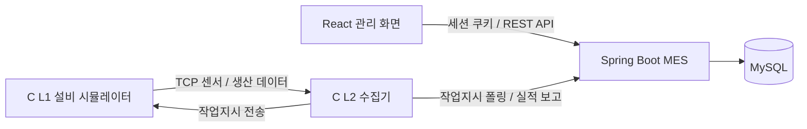

# 🔋 이음 배터리 MES Simulator

12V 차량용 납축전지 생산 과정의 **작업지시 → 공정 진행 → 품질검사 → 완제품 LOT → 자재 투입 이력**을 연결하는 제조실행시스템(MES)입니다.

분리된 생산·품질·재고 정보를 LOT 단위로 연결해, 생산 현황을 확인하고 불량 발생 공정과 사용 자재를 추적할 수 있도록 구성했습니다.

> 이 저장소는 팀 프로젝트 결과물을 **홍유나의 개인 포트폴리오**로 정리한 복사본입니다. 프로젝트 전체 기능은 팀이 함께 개발했으며, 개인 담당 범위는 아래에 구분했습니다.

## 프로젝트 개요

| 항목 | 내용 |
| --- | --- |
| 프로젝트 | 이음(EUM) 배터리 MES |
| 개발 기간 | 2026.07.08 ~ 2026.07.29 |
| 발표 | 2026.07.30 |
| 구성 | 5인 팀 프로젝트 |
| 포트폴리오 작성자 | 홍유나 |
| 전체 기술 구성 | React · Spring Boot · MySQL · C |

실제 설비 없이도 MES의 데이터 흐름을 구성할 수 있도록, C로 설비(L1)와 데이터 수집기(L2)를 구현한 팀 프로젝트 모듈입니다. 6개 공정을 TCP로 연결하고 작업지시·생산·품질·환경 데이터를 MES 서버와 주고받습니다.

## 주요 기능

| 모듈 | 역할 |
| --- | --- |
| L1 `mes_machine_c` | 6개 공정 설비 시뮬레이션, 생산 수량 처리, 센서·품질 측정 데이터 생성 |
| 공정 간 큐 | 전극부터 포장까지 생산 흐름을 큐와 스레드로 연결 |
| TCP 프로토콜 | STX/ETX 검증, 리틀엔디언 데이터 인코딩·디코딩 |
| L2 `mes_equipment_c` | 설비별 TCP 수집 스레드, 작업지시 폴링·전송, HTTP 실적·환경 보고 |
| 연동 | 설비 포트가 포함된 machineId로 MES 설비·공정과 매핑 |
| 테스트 소스 | 큐·패킷·보고 API 테스트 및 Python 가짜 설비·서버 |

## 홍유나 담당 업무와 저장소 위치

노션 [일정관리(WBS)](https://app.notion.com/p/3f6cb363cc93801b8402ef3be3be3f55)의 담당자 기록을 기준으로 정리했습니다.

- **생산관리 화면:** 작업지시 목록, 등록·상세 Drawer, 완제품 LOT 목록·상세 화면 구현
- **기준정보 화면:** 자재 기본정보, 작업자 관리, BOM 관리 화면 구현
- **공통 화면 협업:** 등록·수정·상세를 Drawer로 여는 방식 정의, Drawer 너비 통일
- **프로젝트 문서:** 프로젝트 개요·요구사항, 도메인 지식·시나리오, API 명세서·매핑 최종 정리

WBS에는 초기 작업지시 등록·수정 Drawer 업무가 함께 기재되어 있으나, 이 복사본의 최종 코드는 **작업지시 등록·조회**를 제공합니다. 작업지시 수정 API는 구현되어 있지 않습니다.

홍유나의 확인된 담당 범위는 생산관리·기준정보 **프론트엔드 화면과 분석/API 문서 정리**입니다. 시뮬레이터는 팀 전체 시스템 구조와 데이터 연동을 설명하기 위해 함께 보관했습니다. C 시뮬레이터 전체를 홍유나의 단독 구현으로 표시하지 않았습니다.

작업지시·완제품 LOT 화면의 데이터가 어디서 생성되고 전달되는지 이 모듈을 통해 확인할 수 있습니다. 담당 화면 코드는 [프론트엔드 저장소](https://github.com/h-yuna-lab/MES-Battery-frontend#홍유나-담당-업무)에 있습니다.

## 시스템 구조



전극 → 조립 → 활성화 → 팩 → 검사 → 포장의 6개 공정에서 발생한 데이터를 백엔드에 전달하고, 프론트엔드에서 작업지시·LOT·품질·재고를 조회합니다.


## 통신 프로토콜

[L1 프로토콜 정의](mes_machine_c/protocol.h)와 [L2 프로토콜 정의](mes_equipment_c/protocol.h)는 같은 패킷 형식을 사용합니다.

| 유형 | 형식·내용 |
| --- | --- |
| 기본 패킷 | `[STX 1][type 1][value 4][ETX 1]`, 총 7바이트 |
| 검사 패킷 | `[STX 1][type 1][전압 4][용량 4][저항 4][예약 1][ETX 1]`, 총 16바이트 |
| `0x10 / 0x11 / 0x12` | 온도 / 습도 / 전압 |
| `0x20` | L2→L1 작업지시, L1→L2 생산실적 |
| `0x31 ~ 0x36` | 전극 두께, 조립 정렬, 활성화 전류, 체결 토크, 검사 품질, 포장 중량 |

4바이트 수치는 리틀엔디언 정수로 직렬화하며 검사 데이터는 전압·용량 등의 소수 단위를 정수 배율로 표현합니다. 센서 값은 시뮬레이션용 생성 값이며 실물 배터리의 공정 규격을 보증하는 데이터는 아닙니다.

## 기술 스택

- C11 · GCC · Make
- TCP Socket · pthread
- libcurl: MES HTTP 요청
- cJSON: JSON 요청·응답 처리
- Python: 연동 테스트 보조 도구

## 폴더 구조

```text
mes_machine_c/
  main.c        # 6개 공정 설비와 생산 흐름
  queue.c/h     # 공정 간 큐
  net.c/h       # TCP 소켓
  protocol.c/h  # 패킷 처리
  Makefile
mes_equipment_c/
  main.c        # 수집기 실행과 폴링
  collector.c/h # 설비별 수집·처리
  api_client.c/h# MES HTTP 연동
  config.h      # 서버 주소·공정 포트·폴링 주기
  net.c/h
  protocol.c/h
  Makefile
```

## 실행 방법

먼저 [백엔드](https://github.com/h-yuna-lab/MES-Battery-backend)를 실행하고 제품·BOM·자재 재고·작업지시를 준비합니다. [config.h](mes_equipment_c/config.h)의 서버 주소는 기본 `http://localhost:8111/`이며 폴링 간격은 5초입니다. L1과 L2가 같은 컴퓨터에서 실행되는 설정입니다.

### 빌드 준비

GCC, Make, pthread, libcurl, cJSON, pkg-config가 필요합니다. Linux 예시:

```bash
sudo apt install build-essential libcurl4-openssl-dev libcjson-dev pkg-config
```

macOS는 컴파일 도구를 준비한 후 `brew install curl cjson pkg-config`를 사용합니다. Windows는 MSYS2 MinGW64 환경에서 Makefile 주석의 패키지를 설치합니다.

```bash
pacman -S mingw-w64-x86_64-gcc mingw-w64-x86_64-make mingw-w64-x86_64-curl mingw-w64-x86_64-cjson mingw-w64-x86_64-pkg-config
```

### L1과 L2 실행

프로젝트 루트에서 각각 별도 터미널로 실행합니다.

```bash
# 터미널 1: L1
cd mes_machine_c
make
./mes_machine
```

```bash
# 터미널 2: L2
cd mes_equipment_c
make
./mes_equipment
```

Windows의 MinGW Make는 환경에 따라 `mingw32-make`를 사용하고, 실행 파일 이름은 `mes_machine.exe` / `mes_equipment.exe`입니다. 빌드 결과물은 저장소에 포함하지 않았습니다.

| 공정 | TCP 포트 | 기본 machineId |
| --- | --- | --- |
| 전극 | 5006 | `LINE-01-M01-5006` |
| 조립 | 5007 | `LINE-01-M01-5007` |
| 활성화 | 5008 | `LINE-01-M01-5008` |
| 팩 | 5009 | `LINE-01-M01-5009` |
| 검사 | 5010 | `LINE-01-M01-5010` |
| 포장 | 5011 | `LINE-01-M01-5011` |

작업지시 폴링에는 기본 `LINE-01-M01`을 사용하고, 공정별 실적·환경 보고에는 위처럼 포트가 붙은 machineId를 사용합니다. 백엔드 초기 설비 포트와 L2의 보고용 machineId 생성 규칙이 일치해야 합니다. 사용 포트가 이미 점유되어 있다면 관련 L1·L2·백엔드 설정을 함께 조정합니다.

## 테스트와 확인 범위

원본에는 [패킷 테스트](mes_machine_c/protocol_test.c), [큐 테스트](mes_machine_c/queue_test.c), [실적 보고 테스트](mes_equipment_c/test_report_production.c), [가짜 백엔드](mes_equipment_c/fake_backend.py) 등의 테스트 도구가 있습니다.

이번 포트폴리오 정리에서는 소스·Makefile·프로토콜·연결 지점을 검토했습니다. 현재 환경에 C 빌드 도구와 서버/DB가 없어 **시뮬레이터 빌드 및 실제 백엔드 연동 테스트는 실행하지 않았습니다**.

## 관련 자료

| 구분 | 포트폴리오 저장소 |
| --- | --- |
| 프론트엔드 | [MES-Battery-frontend](https://github.com/h-yuna-lab/MES-Battery-frontend) |
| 백엔드 | [MES-Battery-backend](https://github.com/h-yuna-lab/MES-Battery-backend) |
| 설비 시뮬레이터 | [MES-Battery-Simulator](https://github.com/h-yuna-lab/MES-Battery-Simulator) |

- [프로젝트 노션](https://app.notion.com/p/3f6cb363cc938094bfe2ea7b5bf44d7c)
- [원본 팀 저장소 / master](https://github.com/pyyzzz/MES-Battery-Simulator/tree/master)
- [복사 기준과 변경 내역](docs/SOURCE.md)
