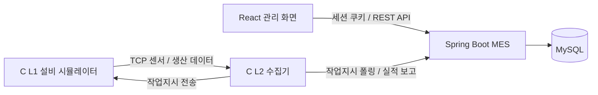

# 🔋 이음 배터리 MES Backend

12V 차량용 납축전지 생산 과정의 **작업지시 → 공정 진행 → 품질검사 → 완제품 LOT → 자재 투입 이력**을 연결하는 제조실행시스템(MES)입니다.

분리된 생산·품질·재고 정보를 LOT 단위로 연결해, 생산 현황을 확인하고 불량 발생 공정과 사용 자재를 추적할 수 있도록 구성했습니다.

> 이 저장소는 팀 프로젝트 결과물을 **홍유나의 개인 포트폴리오**로 정리한 복사본입니다. 프로젝트 전체 기능은 팀이 함께 개발했으며, 개인 담당 범위는 아래에 구분했습니다.

## 프로젝트 개요

| 항목 | 내용 |
| --- | --- |
| 프로젝트 | 이음(EUM) 배터리 MES |
| 개발 기간 | 2026.07.08 ~ 2026.07.29 |
| 발표 | 2026.07.30 |
| 구성 | 5인 팀 프로젝트 |
| 포트폴리오 작성자 | 홍유나 |
| 전체 기술 구성 | React · Spring Boot · MySQL · C |

## 주요 기능

| 영역 | 기능 |
| --- | --- |
| 인증·권한 | Spring Security 세션 로그인·로그아웃·사용자 조회, BCrypt 암호화, 메서드 권한 검사 |
| 기준정보 | 작업자·자재·제품·공정·설비 관리, BOM 구성 |
| 작업지시 | BOM·재고 검증 후 등록, 생산 설비에 대기 작업 할당 |
| 생산·LOT | 생산 실적 수신, 제품 LOT 생성·갱신, 공정별 투입·완료 처리 |
| 재고 | 자재 LOT 기반 FIFO 투입, 입출고 이력, 재고 및 안전재고 조회 |
| 품질 | 공정별 측정값·규격 검사, 합격·불량 기록, 검사 추이·유형 집계 |
| 모니터링 | 설비 환경 데이터 수신, 대시보드 KPI 및 알림 |
| 추적성 | LOT별 공정·설비·품질·자재 이력, 일별 생산 리포트 |

## 홍유나 담당 업무

노션 [일정관리(WBS)](https://app.notion.com/p/3f6cb363cc93801b8402ef3be3be3f55)의 담당자 기록을 기준으로 정리했습니다.

- **생산관리 화면:** 작업지시 목록, 등록·상세 Drawer, 완제품 LOT 목록·상세 화면 구현
- **기준정보 화면:** 자재 기본정보, 작업자 관리, BOM 관리 화면 구현
- **공통 화면 협업:** 등록·수정·상세를 Drawer로 여는 방식 정의, Drawer 너비 통일
- **프로젝트 문서:** 프로젝트 개요·요구사항, 도메인 지식·시나리오, API 명세서·매핑 최종 정리

WBS에는 초기 작업지시 등록·수정 Drawer 업무가 함께 기재되어 있으나, 이 복사본의 최종 코드는 **작업지시 등록·조회**를 제공합니다. 작업지시 수정 API는 구현되어 있지 않습니다.

홍유나의 확인된 주요 구현 범위는 **프론트엔드 생산관리·기준정보 화면과 프로젝트/API 문서**입니다. 이 백엔드 저장소는 해당 화면이 연결되는 팀 서버를 함께 보여주기 위한 포트폴리오 복사본이며, 백엔드 전체를 개인 단독 구현으로 표기하지 않았습니다.

| 담당 화면과 연결되는 서버 기능 | 관련 코드 |
| --- | --- |
| 작업지시 등록·조회, BOM·재고 검증 | [WorkOrderController](src/main/java/com/mes/backend/controller/WorkOrderController.java) · [WorkOrderService](src/main/java/com/mes/backend/service/WorkOrderService.java) |
| 완제품 LOT 목록·상세 | [ProductLotController](src/main/java/com/mes/backend/controller/ProductLotController.java) · [ProductLotService](src/main/java/com/mes/backend/service/ProductLotService.java) |
| 자재·작업자 기준정보 | [MaterialController](src/main/java/com/mes/backend/controller/MaterialController.java) · [WorkerController](src/main/java/com/mes/backend/controller/WorkerController.java) |
| 제품별 BOM | [BomController](src/main/java/com/mes/backend/controller/BomController.java) · [BomService](src/main/java/com/mes/backend/service/BomService.java) |

## 기술 스택

| 구분 | 사용 기술 |
| --- | --- |
| 언어 | Java 17 |
| 서버 | Spring Boot 4.1.0 · Spring Web MVC |
| 데이터 | Spring Data JPA · Hibernate · MySQL |
| 인증 | Spring Security · 세션 쿠키 · BCrypt |
| 기타 | Lombok · Gradle Wrapper 9.5.1 |

버전은 복사한 브랜치의 [build.gradle](build.gradle) 및 [Gradle 설정](gradle/wrapper/gradle-wrapper.properties) 기준입니다.

## 시스템 구조



전극 → 조립 → 활성화 → 팩 → 검사 → 포장의 6개 공정에서 발생한 데이터를 백엔드에 전달하고, 프론트엔드에서 작업지시·LOT·품질·재고를 조회합니다.

### 생산 데이터 처리 흐름

1. 관리자가 제품·BOM·자재 재고를 준비하고 작업지시를 등록합니다.
2. L2 수집기가 기본 `machineId`로 작업지시를 폴링합니다.
3. 백엔드가 대기 작업을 할당하고 제품 LOT를 준비합니다.
4. L1에서 생성한 생산·품질 데이터를 L2가 HTTP로 보고합니다.
5. 서버가 공정·검사·자재 투입 이력을 기록하고 실적과 LOT 상태를 갱신합니다.
6. React 화면에서 진행률, 품질 결과, 자재 이력을 조회합니다.

핵심 처리 코드는 [ProductionService](src/main/java/com/mes/backend/service/ProductionService.java)에 있습니다. 제품별 BOM과 자재 LOT를 연결하고, FIFO 투입 이력을 제품 LOT와 함께 저장해 추적성 정보를 구성합니다.

## 주요 API

| 경로 | 용도 |
| --- | --- |
| `/api/mes/auth/login`, `/me`, `/logout` | 로그인·현재 사용자·로그아웃 |
| `/api/mes/work-orders` | 작업지시 목록·상세·등록 |
| `/api/mes/product-lots` | 완제품 LOT 목록·상세 |
| `/api/mes/products/{productId}/bom-items` | 제품별 BOM 조회·수정 |
| `/api/mes/materials`, `/workers`, `/processes`, `/equipment`, `/products` | 기준정보 |
| `/api/mes/inventory/*` | 자재 재고·자재 LOT·입출고 |
| `/api/mes/quality/*` | 검사 기록·요약·추이·불량 집계 |
| `/api/mes/report/*` | LOT 추적·생산 집계 |
| `/api/mes/dashboard`, `/notifications` | 대시보드·알림 |
| `GET /api/mes/machine/poll?machineId=...` | 설비 작업지시 조회, 대기 작업이 없으면 204 |
| `POST /api/mes/machine/report` | 생산·품질 실적 수신 |
| `POST /api/mes/machine/environment` | 온도·습도·전압 수신 |

정확한 메서드·요청·응답은 [Controller](src/main/java/com/mes/backend/controller)와 [DTO](src/main/java/com/mes/backend/dto)를 기준으로 확인할 수 있습니다. API 경로별 접두사를 생략한 표 항목은 동일한 `/api/mes` 아래 경로입니다.

## 실행 방법

Java 17 및 MySQL을 준비합니다. MySQL에 `mes_portfolio` 데이터베이스를 만들고, 해당 DB에 접근 가능한 로컬 사용자를 설정합니다.

```sql
CREATE DATABASE mes_portfolio CHARACTER SET utf8mb4;
```

원본 DB 접속 정보는 공개 복사본에서 제외했습니다. [설정 예시](src/main/resources/application.example.properties)를 복사한 뒤 환경변수로 DB 정보를 지정합니다.

```powershell
Copy-Item src/main/resources/application.example.properties src/main/resources/application.properties
$env:DB_URL = 'jdbc:mysql://localhost:3306/mes_portfolio?serverTimezone=Asia/Seoul&characterEncoding=UTF-8'
$env:DB_USERNAME = '본인의 로컬 DB 사용자'
$env:DB_PASSWORD = '본인의 로컬 DB 비밀번호'
.\gradlew.bat bootRun
```

macOS/Linux에서는 동일한 DB 환경변수를 설정하고 `./gradlew bootRun`으로 실행합니다. 서버 포트는 **8111**입니다. 최초 실행 시 [DataSeeder](src/main/java/com/mes/backend/config/DataSeeder.java)가 관리자(`admin / 1234`), 6개 공정·설비 및 품질 규격을 준비합니다. 제품·자재·BOM·재고 등 생산 준비 데이터는 화면에서 등록합니다.

```powershell
.\gradlew.bat test
.\gradlew.bat build
```

기본 계정과 설비 API 접근 정책은 학습 프로젝트의 로컬 환경 기준입니다. 외부 운영 시 관리자 비밀번호와 설비 인증·접근 정책을 환경에 맞게 설정해야 합니다.

## 확인 범위

복사 브랜치, 컨트롤러·DTO·서비스 흐름 및 프론트엔드 연결 지점을 확인했습니다. 이번 포트폴리오 정리 환경에는 Java/MySQL 실행 환경이 없어 **백엔드 빌드·DB 통합 테스트는 실행하지 않았습니다**. 프론트 화면 캡처는 예시 데이터 기반이며 서버 연동 완료 증거로 사용하지 않았습니다.

## 관련 자료

| 구분 | 포트폴리오 저장소 |
| --- | --- |
| 프론트엔드 | [MES-Battery-frontend](https://github.com/h-yuna-lab/MES-Battery-frontend) |
| 백엔드 | [MES-Battery-backend](https://github.com/h-yuna-lab/MES-Battery-backend) |
| 설비 시뮬레이터 | [MES-Battery-Simulator](https://github.com/h-yuna-lab/MES-Battery-Simulator) |

- [프로젝트 노션](https://app.notion.com/p/3f6cb363cc938094bfe2ea7b5bf44d7c)
- [원본 팀 저장소 / hyun_testman](https://github.com/pyyzzz/MES-Battery-backend/tree/hyun_testman)
- [복사 기준과 변경 내역](docs/SOURCE.md)
