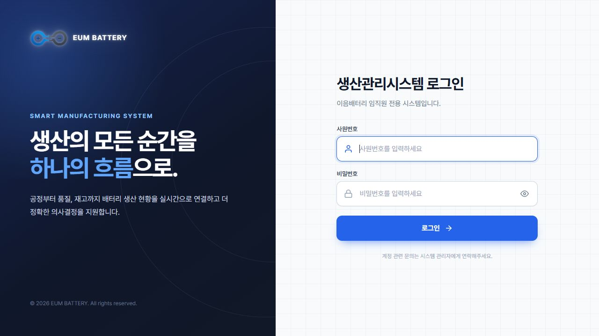
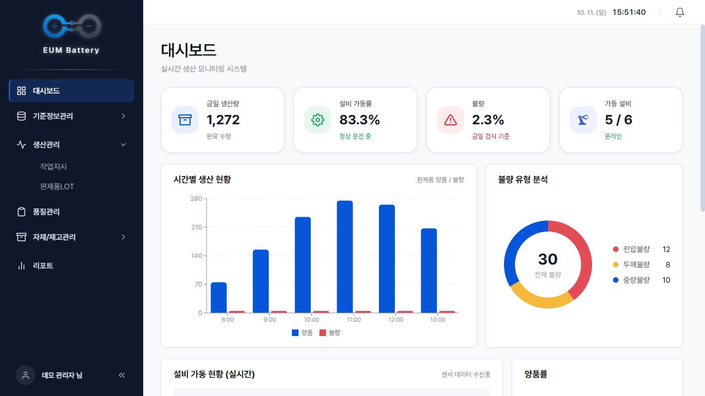
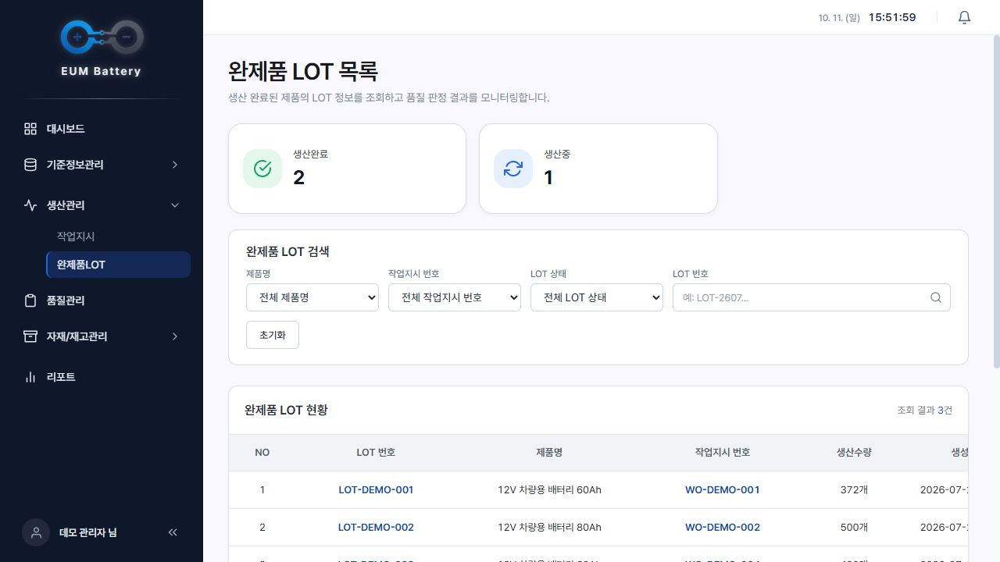
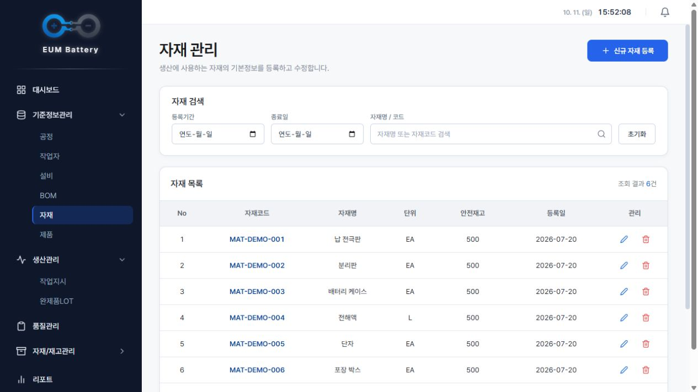
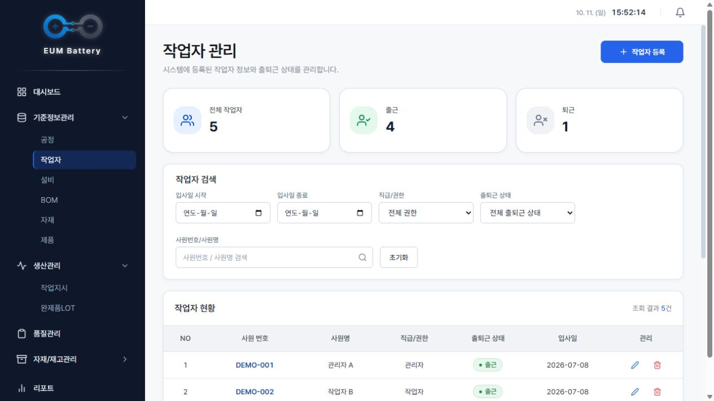
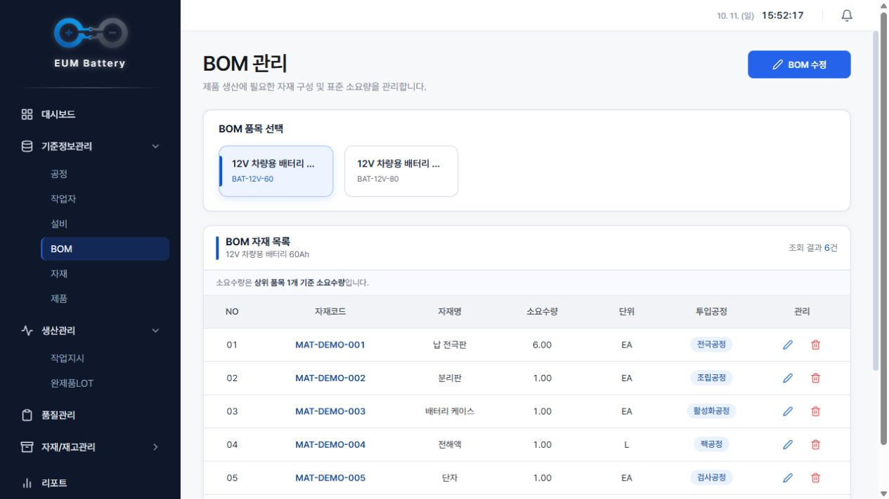

# 🔋 이음 배터리 MES

12V 차량용 납축전지 생산의 작업지시·공정·품질검사·완제품 LOT·자재 투입 이력을 연결하는 제조실행시스템(MES)입니다.

**5인 팀 프로젝트를 홍유나의 개인 포트폴리오로 정리한 통합 저장소**입니다. React 화면, Spring Boot 서버, C 설비 시뮬레이터를 한곳에 모았습니다. 개인 담당은 **생산관리·기준정보 화면과 프로젝트/API 문서 정리**입니다.

## 프로젝트 개요

| 항목 | 내용 |
| --- | --- |
| 개발 기간 | 2026.07.08 ~ 2026.07.29 |
| 발표 | 2026.07.30 |
| 구성 | 5명 |
| 화면 | React · JavaScript · styled-components |
| 서버·DB | Java 17 · Spring Boot · JPA · MySQL |
| 설비 시뮬레이터 | C · TCP Socket · pthread · libcurl · cJSON |
| 공정 | 전극·조립·활성화·팩·검사·포장 |

## 홍유나 담당 업무

- 작업지시 목록·등록·상세 Drawer
- 완제품 LOT 목록·상세, 공정·품질·자재 이력 확인 화면
- 자재 기본정보·작업자 관리·BOM 관리 화면
- 공통 Drawer 방식 정의와 너비 통일 협업
- 반복되는 검색 필터·날짜 선택·BOM 자재 입력 UI의 공통 컴포넌트 분리
- 제품 검색 런타임 오류 수정, 작업자 사원번호 자동 생성·수정 제한
- 프로젝트 개요·요구사항·도메인·시나리오·API 명세서·매핑 문서 정리

담당 화면의 UI와 Drawer 구조는 홍유나가 구현했고, 각 화면의 서버 API 연동과 작업지시 목록의 주기적 갱신·BOM 자재 소요량 합산 및 재고 부족 시 등록 차단은 팀원이 구현했습니다. 최종 코드의 작업지시 기능은 **등록·조회**이며 수정 API는 없습니다. 백엔드와 C 시뮬레이터는 담당 화면의 데이터 흐름을 함께 보여주는 팀 결과물입니다. 상세 담당 기능·현재 코드 위치는 [프론트 README](frontend/README.md)에 정리했습니다.

## 저장소 구성

| 위치 | 내용 |
| --- | --- |
| [frontend](frontend/README.md) | React 생산관리·기준정보·품질·재고·리포트 화면 |
| [backend](backend/README.md) | Spring Boot 생산·품질·재고 API, DB·초기 데이터 설정 |
| [simulator](simulator/README.md) | C L1 설비·L2 수집기, TCP 패킷·HTTP 보고 |
| [SOURCE.md](SOURCE.md) | 통합 기준 저장소·커밋·보존 범위 |

각 모듈의 소스·문서·설정 예시·화면 캡처와 기존 커밋 이력을 가져왔습니다.

## 생산 흐름

1. 제품·BOM·자재 재고를 준비하고 작업지시를 등록합니다.
2. L2 수집기가 작업지시를 조회해 L1 설비에 전달합니다.
3. 6개 공정의 생산·품질·환경 데이터를 L2가 서버에 보고합니다.
4. 서버가 실적과 LOT·검사·투입 자재 이력을 반영합니다.
5. React 화면에서 진행률과 품질·LOT·자재 정보를 조회합니다.

## 주요 화면

팀 React 코드를 실제 브라우저에서 실행하고 캡처용 API의 **예시 데이터**를 연결해 촬영한 화면입니다. 실제 공장 데이터나 백엔드 통합 검증 결과가 아닙니다.


| 작업지시 상세 | 작업지시 등록 |
| --- | --- |
|  |  |


<details>
<summary>로그인·대시보드·LOT 목록·자재·작업자·BOM</summary>

### 로그인



### 대시보드 · 팀 공통 기능



### 완제품 LOT 목록



### 자재 관리



### 작업자 관리



### BOM 관리



</details>

촬영 조건은 [화면 캡처 안내](frontend/docs/SCREENSHOTS.md)에 있습니다.

## 실행 방법

Java 17·MySQL·Node.js를 준비하고, [백엔드](backend/README.md)에서 DB·설정·초기 데이터를 먼저 확인합니다.

통합 저장소 루트에서 각각 별도 터미널로 실행합니다.

```powershell
# 터미널 1 · 백엔드
cd backend
.\gradlew.bat bootRun
```

```powershell
# 터미널 2 · 프론트엔드
cd frontend
npm install
npm start
```

화면은 `http://localhost:3000`, 서버는 `http://localhost:8111`입니다. 제품·BOM·자재 재고·작업지시를 준비한 뒤 [시뮬레이터](simulator/README.md)의 L1·L2를 각각 실행합니다.

| 상세 안내 | 내용 |
| --- | --- |
| [프론트 기술 안내](frontend/README.md) | API·세션 설정, 화면 코드·데이터 처리, 빌드 |
| [백엔드 기술 안내](backend/README.md) | DB·초기 데이터·생산 준비, API, 빌드 |
| [시뮬레이터 기술 안내](simulator/README.md) | 운영체제별 의존성·L1/L2 빌드·TCP 포트·서버 연결 |

## 확인 범위

프론트 프로덕션 빌드와 예시 데이터 기반 화면·Drawer는 확인했습니다. 백엔드 빌드·MySQL 통합 실행과 C 시뮬레이터 빌드·서버 연동은 검증하지 않았습니다.

## 프로젝트 회고

### 빈 값 때문에 발생한 검색 오류와 상세 화면 데이터 전달 수정

목록 화면을 정리하는 과정에서 제품 검색의 런타임 오류를 수정했습니다. 기존 코드는 제품 코드·제품명에 바로 toLowerCase()를 호출하고, 등록일에는 split()을 호출했습니다. 값이 비어 있거나 예상한 문자열 형식이 아니면 검색이나 행 표시 과정에서 오류가 날 수 있는 구조였습니다.

검색어와 제품 필드는 빈 값을 먼저 처리하고 문자열로 변환한 뒤 비교하도록 변경했습니다. 등록일도 같은 방식으로 처리했습니다. 또한 테이블에서 제품 코드를 JSX로 표시하면서 해당 필드의 원래 값을 덮어쓰고 있었습니다. 그래서 클릭한 행을 그대로 상세 Drawer에 전달하면 화면 표시용 객체가 상세 데이터로 쓰이는 문제가 있었습니다. 원본 제품을 originalProduct로 별도 보관하고 상세 화면에는 그 원본을 전달하도록 수정했습니다.

이 경험을 통해 API 데이터, 검색에 사용하는 값, 화면 표시용 값의 역할을 구분해야 한다는 점을 배웠습니다. 화면에 보기 좋게 표시된 행이 상세 조회나 수정에도 그대로 사용할 수 있는 데이터라고 생각했던 부분을 돌아보게 되었습니다.

관련 변경: [제품 검색의 빈 값 처리와 원본 상세 데이터 전달](https://github.com/pyyzzz/MES-Battery-frontend/commit/e4cb73e337258645f1638c2bbf614b7445e0e117)

### 여러 관리 화면의 반복 UI를 공통 컴포넌트로 정리

작업지시, 완제품 LOT, 작업자, BOM 화면을 구현하면서 목록마다 검색 필터와 요약 카드의 코드가 반복되었습니다. 같은 종류의 화면인데도 구성과 스타일이 달라지고, 공통 디자인을 바꿀 때 여러 페이지를 각각 수정해야 하는 부담이 있었습니다.

완제품 LOT·작업지시·작업자·BOM 화면에 공용 검색 필터와 요약 카드를 적용했습니다. 작업지시에서는 납기일뿐 아니라 실제 시작일과 완료일을 선택해 기간을 검색하도록 조건을 정리했습니다. 이후 목록의 검색바·테이블과 Drawer 너비도 맞추면서, 업무별 필드와 공통 화면 구조를 나누어 관리하는 방향으로 수정했습니다.

공통화는 모양을 같게 만드는 작업만이 아니라 변경해야 할 지점을 줄이는 작업이라는 점을 배웠습니다. 다만 작업지시와 자재·BOM은 입력 항목과 검증 조건이 다르므로, 공통 컴포넌트가 업무별 요구를 표현할 수 있도록 설계하는 부분은 더 연습해야 한다고 느꼈습니다.

관련 변경: [생산·기준정보 화면 공용 UI 적용](https://github.com/pyyzzz/MES-Battery-frontend/commit/bdae72157e41378a87718559c51c651f95495404) · [목록 검색바·요약카드·테이블 통일](https://github.com/pyyzzz/MES-Battery-frontend/commit/b60499bcc52d129a011c8eb4a432ae970eb3cca8)

### 앞으로 보완할 부분

임시 데이터로 화면을 구현하는 단계부터 빈 값과 실제 API 응답 형식을 함께 고려하고 싶습니다. 등록 화면이 있다는 이유로 API도 같은 기능을 지원한다고 가정하지 않고, 최종 백엔드에서 지원하는 작업지시 등록·조회 범위에 맞춰 화면 동작을 확인해야 합니다. 실제 DB·백엔드·시뮬레이터를 연결해 작업지시 등록부터 생산 결과와 LOT 조회까지 검증하고, 상태별 표시와 오류 처리를 확인하는 것이 남은 과제입니다.

## 출처

- [통합 기준 및 출처 기록](SOURCE.md)
- 원본 팀 [프론트엔드](https://github.com/pyyzzz/MES-Battery-frontend/tree/hyun-testman) · [백엔드](https://github.com/pyyzzz/MES-Battery-backend/tree/hyun_testman) · [시뮬레이터](https://github.com/pyyzzz/MES-Battery-Simulator)
- [프로젝트 Notion](https://app.notion.com/p/3f6cb363cc938094bfe2ea7b5bf44d7c)
