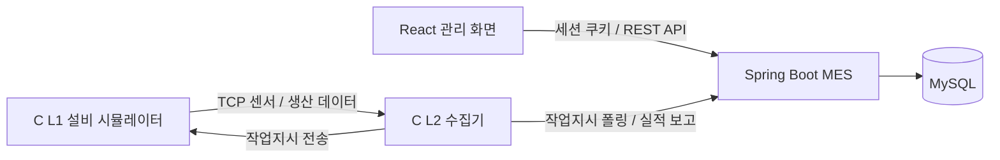

# 🔋 이음 배터리 MES Frontend

12V 차량용 납축전지 생산 과정의 **작업지시 → 공정 진행 → 품질검사 → 완제품 LOT → 자재 투입 이력**을 연결하는 제조실행시스템(MES)입니다.

분리된 생산·품질·재고 정보를 LOT 단위로 연결해, 생산 현황을 확인하고 불량 발생 공정과 사용 자재를 추적할 수 있도록 구성했습니다.

> 이 저장소는 팀 프로젝트 결과물을 **홍유나의 개인 포트폴리오**로 정리한 복사본입니다. 프로젝트 전체 기능은 팀이 함께 개발했으며, 개인 담당 범위는 아래에 구분했습니다.

## 프로젝트 개요

| 항목 | 내용 |
| --- | --- |
| 프로젝트 | 이음(EUM) 배터리 MES |
| 개발 기간 | 2026.07.08 ~ 2026.07.29 |
| 발표 | 2026.07.30 |
| 구성 | 5인 팀 프로젝트 |
| 포트폴리오 작성자 | 홍유나 |
| 전체 기술 구성 | React · Spring Boot · MySQL · C |

## 주요 기능

| 영역 | 기능 |
| --- | --- |
| 인증 | 사원번호 로그인, 세션 복원, 로그아웃, 권한별 조작 버튼 |
| 대시보드 | 생산량, 설비 가동률, 불량률, 시간별 생산, 설비·자재·근무자 현황 |
| 기준정보 | 공정·설비·작업자·제품·자재 관리, 제품별 BOM 구성 |
| 생산관리 | 작업지시 검색·등록·진행률·상세, 완제품 LOT 목록·상세 |
| 품질관리 | 검사 기록, 검사 요약, 추이, 불량 유형 |
| 자재·재고 | 자재 재고, 입고, 자재 LOT, 입출고 이력 |
| 리포트 | LOT별 생산·품질·자재·공정 추적, 일별 생산 및 공정 집계 |

## 홍유나 담당 업무

노션 [일정관리(WBS)](https://app.notion.com/p/3f6cb363cc93801b8402ef3be3be3f55)의 담당자 기록을 기준으로 정리했습니다.

- **생산관리 화면:** 작업지시 목록, 등록·상세 Drawer, 완제품 LOT 목록·상세 화면 구현
- **기준정보 화면:** 자재 기본정보, 작업자 관리, BOM 관리 화면 구현
- **공통 화면 협업:** 등록·수정·상세를 Drawer로 여는 방식 정의, Drawer 너비 통일
- **프로젝트 문서:** 프로젝트 개요·요구사항, 도메인 지식·시나리오, API 명세서·매핑 최종 정리

WBS에는 초기 작업지시 등록·수정 Drawer 업무가 함께 기재되어 있으나, 이 복사본의 최종 코드는 **작업지시 등록·조회**를 제공합니다. 작업지시 수정 API는 구현되어 있지 않습니다.

| 담당 화면 | 구현 내용 | 관련 코드 |
| --- | --- | --- |
| 작업지시 목록 | 상태·번호·납기일 검색, 상태 집계, 진행률 표시, 주기적 목록 갱신 | [WorkOrderList](src/pages/production/WorkOrderList.js) |
| 작업지시 등록·상세 | 제품·지시수량·납기일 입력, BOM 및 자재 재고 확인, 상세 Drawer | [등록](src/pages/production/WorkOrderNewEdit.js) · [상세](src/pages/production/WorkOrderDetail.js) |
| 완제품 LOT | 제품·작업지시·상태 검색, 수량·검사 합격률, 공정·자재·설비 상세 탭 | [목록](src/pages/production/ProductLotList.js) · [상세](src/pages/production/ProductLotDetail.js) |
| 자재 기준정보 | 자재코드·이름·단위·안전재고, 검색·등록·수정·삭제 | [목록](src/pages/master/MaterialList.js) · [입력](src/pages/master/MaterialNewEdit.js) |
| 작업자 | 사원번호·이름·권한·출퇴근 상태·입사일, 검색·등록·수정·상세 | [목록](src/pages/master/WorkerList.js) · [입력](src/pages/master/WorkerNewEdit.js) · [상세](src/pages/master/WorkerDetail.js) |
| BOM | 제품별 자재 구성, 표준 소요수량·투입공정, 수정·상세 Drawer | [목록](src/pages/master/BomList.js) · [수정](src/pages/master/BomEdit.js) · [상세](src/pages/master/BomDetail.js) |

현재 소스는 담당 화면 구현 이후 팀의 API 연동과 통합 수정을 포함한 버전입니다. 위 링크는 담당 기능의 현재 코드 위치이며, 파일 전체를 개인 단독 작성으로 주장하는 의미는 아닙니다.

## 구현 흐름과 경험

### 목록에서 상세까지 이어지는 생산관리 UI

작업지시의 영문 상태 값을 화면용 한국어 상태로 변환하고, 지시수량과 실적수량으로 진행률을 계산합니다. 목록은 2초 간격으로 갱신하며, 선택된 작업지시도 최신 목록 값으로 반영합니다. 상세 화면을 Drawer로 열어 목록의 검색 맥락을 유지하도록 구성했습니다.

### 작업지시와 BOM·자재 재고 연결

제품을 선택하면 BOM을 조회하고, `제품 1개당 소요량 × 지시수량`을 현재 자재 재고와 비교합니다. 동일 자재가 여러 BOM 항목에 존재하는 경우 필요량을 합산합니다. 화면의 사전 확인과 함께 백엔드에서도 등록 시 재고를 검증합니다.

### LOT 중심의 정보 구성

완제품 LOT 목록에서 상세 조회 API를 호출해 검사 합격률과 공정·자재 이력을 표시합니다. 생산상태·검사결과·투입자재를 하나의 LOT 상세 화면 안에서 연결하는 방식으로 제조 도메인의 데이터 관계를 학습했습니다.

## 기술 스택

| 구분 | 사용 기술 |
| --- | --- |
| UI | React 19 · JavaScript |
| 라우팅 | React Router 7 |
| 스타일 | styled-components 6 · styled-reset · Pretendard |
| API | Axios · 세션/쿠키 인증 |
| 시각화·입력 | Recharts 3 · react-datepicker · react-icons |
| 빌드 | Create React App / react-scripts 5 |

세부 의존성과 버전 범위는 [package.json](package.json), 원본 잠금 파일은 [yarn.lock](yarn.lock)에 있습니다.

## 시스템 구조



전극 → 조립 → 활성화 → 팩 → 검사 → 포장의 6개 공정에서 발생한 데이터를 백엔드에 전달하고, 프론트엔드에서 작업지시·LOT·품질·재고를 조회합니다.

## 주요 화면

아래는 **이 저장소의 React 코드를 실제 브라우저에서 실행해 촬영한 화면**입니다. 로그인 이후 화면은 캡처 전용 로컬 API의 **예시 데이터**를 사용했으며, 실제 공장 데이터나 백엔드 통합 테스트 결과를 의미하지 않습니다. 촬영 환경과 전체 목록은 [화면 캡처 안내](docs/SCREENSHOTS.md)에 정리했습니다.

### 로그인


### 대시보드 — 팀 공통 기능


### 작업지시 관리 — 담당 화면


| 작업지시 상세 | 작업지시 등록 |
| --- | --- |
|  |  |

### 완제품 LOT — 담당 화면


### 자재·작업자·BOM — 담당 화면


## 실행 방법

Node.js와 패키지 매니저가 필요합니다. 백엔드는 `http://localhost:8111`에서 먼저 실행합니다.

```bash
npm install
npm start
```

기본 접속 주소는 `http://localhost:3000`입니다. API 요청은 상대경로 `/api/mes/...`를 사용하며, [package.json](package.json)의 개발 프록시가 `http://localhost:8111`로 전달합니다. Axios의 `withCredentials: true`로 세션 쿠키를 사용합니다.

백엔드 최초 로컬 실행 시 기본 관리자 계정은 `admin / 1234`입니다([DataSeeder](../backend/src/main/java/com/mes/backend/config/DataSeeder.java)). 학습용 초기 계정이므로 외부 운영 전에 비밀번호와 계정 정책을 변경해야 합니다.

```bash
npm run build
```

정적 빌드 배포에서는 CRA 개발 프록시가 동작하지 않으므로 `/api` 요청을 백엔드로 전달하도록 웹 서버를 설정해야 합니다.

## 확인 결과

- 포트폴리오 정리 시 프론트엔드 프로덕션 빌드 성공
- 브라우저에서 로그인, 대시보드, 작업지시 등록·상세, LOT 상세, 자재·작업자·BOM 화면 확인
- 화면 캡처 10장 추가
- 이번 정리에서는 Spring Boot·MySQL·C 시뮬레이터의 전체 연동 실행은 수행하지 않음

설치·빌드 환경 및 원본과의 차이는 [출처와 검증 기록](docs/SOURCE.md)을 참고해주세요.

## 관련 자료

| 구분 | 포트폴리오 저장소 |
| --- | --- |
| 프론트엔드 | [MES-Battery-frontend](../frontend/README.md) |
| 백엔드 | [MES-Battery-backend](../backend/README.md) |
| 설비 시뮬레이터 | [MES-Battery-Simulator](../simulator/README.md) |

- [프로젝트 노션](https://app.notion.com/p/3f6cb363cc938094bfe2ea7b5bf44d7c)
- [원본 팀 저장소 / hyun-testman](https://github.com/pyyzzz/MES-Battery-frontend/tree/hyun-testman)
- [팀 개발 당시 README](docs/README.original.md)

팀 결과물의 출처를 유지하면서 개인 담당 기능, 실행 방법, 실제 화면을 포트폴리오용으로 정리했습니다.


## 프로젝트 회고

작업지시, 완제품 LOT, 자재·작업자·BOM 관리 화면과 설계 문서 정리를 담당했습니다. 생산관리 화면을 구현하려면 각 화면의 기능뿐 아니라 작업지시와 자재, 생산 결과가 어떻게 연결되는지 이해해야 한다는 점을 배웠습니다. 공통 Drawer 방식과 너비를 맞추는 협업을 통해 화면 간 일관성의 중요성도 경험했습니다.

포트폴리오 정리에서는 예시 데이터를 연결해 화면을 확인했지만, 실제 백엔드·DB·시뮬레이터를 연결한 전체 흐름은 추가 검증이 필요했습니다. 다음 프로젝트에서는 화면 구현과 함께 실제 API 연동을 단계별로 확인하고, 등록부터 생산 결과 조회까지 이어지는 시나리오로 검증하고 싶습니다.
